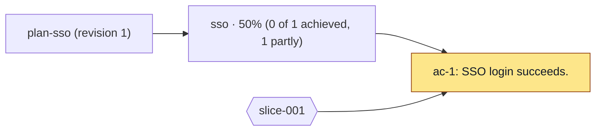

# ORBIT

ORBIT is a portable planning and reconciliation standard for durable software intent, current project reality, and the next bounded execution change.

ORBIT is part of [Agent SDLC](https://agentsdlc.ai). Visit the project website at [orbitspec.dev](https://orbitspec.dev).

This repository is the source for the standard, its schemas, examples, validators, and skills. The website is published separately so the standard can be used without a website or a specific coding harness.

## Current status

ORBIT v0.1 is under development. The repository begins with the four record schemas and examples that currently live in the website repository. The initial Plan, Project Snapshot, Reconciliation, and Execution Slice are under [`orbit/`](orbit/).

## Records

- **Plan** — durable intent, outcomes, acceptance criteria, constraints, and planning knowledge.
- **ProjectSnapshot** — point-in-time project and repository state.
- **Reconciliation** — assessment of a Plan against observed evidence.
- **ExecutionSlice** — the next bounded change justified by a Reconciliation.

A Plan revision is immutable after a Reconciliation or slice references it. See [Revising a criterion](docs/revising-a-criterion.md) for when a change needs a new Plan revision.

## Validate

```sh
npm install
npm test
```

The validator checks every example and every record under `orbit/` against its JSON Schema and verifies the cross-record references in the complete fixture set.

The portable CLI exposes the same operations to any harness:

```sh
npx orbit validate --all
npx orbit validate --all --root docs/orbit
npx orbit plan examples/plan-minimal.json
npx orbit snapshot examples/project-snapshot-minimal.json
npx orbit reconcile examples/reconciliation-minimal.json
npx orbit slice examples/slice-minimal.json
```

`orbit validate --all` validates the package fixture set (`examples/` and `orbit/`).

`orbit validate --all --root <directory>` validates only the record directories under that root (`plans/`, `snapshots/`, `reconciliations/`, `slices/`). It does not read the package fixtures. Harness adapters that store project records outside this repository must pass `--root`.

A record root can also hold superseded records under `history/`, in the same four subdirectories. Move the superseded Plan revision and its Reconciliation to `history/` when a new Plan revision arrives. Validation applies these rules:

- The command schema-validates every record under `history/`.
- History records resolve references. They are never current.
- Each Plan `id` has at most one revision outside `history/`.
- A current record can depend on a history record only through `basedOn` provenance on an Execution Slice. A delivered slice keeps the `basedOn` it was cut from.
- A Plan `id` and `revision`, or any other record `id`, must be unique across `history/` and the current directories.

`orbit progress` does not read `history/`. See [AgDR-0009](docs/agdr/AgDR-0009-validate-resolves-history.md).

Harness adapters should call these commands and preserve their exit status. They must not replace ORBIT validation with harness-specific rules.

The lifecycle commands also create records from explicit inputs:

```sh
npx orbit snapshot --project my-project --id snapshot-2026-10-11 \
  --repository app --path . --output snapshots/snapshot-2026-10-11.json
npx orbit snapshot --project my-project --id snapshot-web-api \
  --repository web --path ../web \
  --repository api --path ../api \
  --output snapshots/snapshot-web-api.json
npx orbit reconcile --plan plans/plan.json --snapshot snapshots/snapshot-2026-10-11.json \
  --id reconciliation-2026-10-11 --output reconciliations/reconciliation-2026-10-11.json
npx orbit slice --plan plans/plan.json --reconciliation reconciliations/reconciliation-2026-10-11.json \
  --id slice-login-form --outcome outcome-id \
  --objective "Bounded change" --why "Evidence supports this change" \
  --output slices/slice-login-form.json
```

### Record IDs

Pass `--id <slug>` to name each record. This is the recommended usage: a slug such as `slice-login-form` tells a reader what the record is. Without `--id`, the command uses a fallback ID of the form `<kind>-<plan or project>-<UTC timestamp>` and prints a notice on standard error. The command scans nearby records, so a fallback ID never repeats an existing ID. If a record with the same fallback ID already exists, for example because two slices were cut in the same second, the command adds a numeric suffix (`-2`, `-3`) and the notice names the clash.

### Slice provenance

`orbit slice` fills `basedOn.repositories` with the repository IDs and commits from the Project Snapshot that the Reconciliation names. A fresh slice therefore passes `orbit validate --all --root <directory>` without hand edits.

The command finds the Project Snapshot in this order:

1. The file given by `--snapshot <file>`. Its ID must match the Reconciliation's `projectSnapshotId`.
2. `snapshots/` under `--root <directory>`.
3. `snapshots/` next to the Reconciliation's record directory, then the Reconciliation's own directory.
4. `snapshots/` and `orbit/snapshots/` under the working directory.

Pass `--repository <id>` one or more times to limit the map to the named repositories. An ID that the Project Snapshot does not hold is an error. If the command cannot find the Project Snapshot, it prints a notice and leaves `basedOn.repositories` empty.

```sh
npx orbit slice --root docs/orbit \
  --plan docs/orbit/plans/plan.json \
  --reconciliation docs/orbit/reconciliations/reconciliation-2026-10-11.json \
  --id slice-api-auth --outcome outcome-id --repository api \
  --objective "Bounded change" --why "Evidence supports this change" \
  --output docs/orbit/slices/slice-api-auth.json
```

Before a provider write, validate and preview the complete record chain:

```sh
npx orbit sync github \
  --plan examples/plan-sso.json \
  --snapshot examples/project-snapshot-2026-09-14.json \
  --reconciliation examples/reconciliation-001.json \
  --slice examples/slice-001.json \
  --repo owner/repository \
  --dry-run
```

The GitHub adapter rejects inconsistent projects, Plan revisions, outcomes, acceptance criteria, incomplete Reconciliation assessments, and repository provenance before it calls GitHub. Remove `--dry-run` only after you review the proposed issue. The CLI does not infer intent. Harnesses provide explicit inputs and apply their own workflow rules.

## Progress

`orbit progress --root <directory> [--plan <id>] [--output <file>] [--direction TD|LR]` produces a Markdown progress report with a Mermaid graph, an Outcomes table, and an acceptance-criteria table:

```sh
node bin/orbit.js progress --root orbit
node bin/orbit.js progress --root docs/orbit --plan plan-sso --output reports/progress.md
node bin/orbit.js progress --root orbit --direction TD
```

The graph defaults to left-to-right (`graph LR`). Use `--direction TD` for top-down or `--direction LR` explicitly for left-to-right. Values are case-sensitive; anything other than `TD` or `LR` is rejected.

The command reads JSON records from `plans/`, `reconciliations/`, and `slices/` under the root and validates them with the existing schemas before producing output. It selects the highest Plan `revision`, the latest Reconciliation for that Plan ID by `reconciledAt` (ties use ID order), and every Slice for that Plan ID. If multiple Plan IDs exist, pass `--plan <id>`; otherwise the command reports the ambiguity. Reconciliations and slices may come from earlier Plan revisions. Snapshots are not required.

Without a Reconciliation, or for a criterion without an assessment, the status is `not-verified`. Each outcome's percentage averages its criteria: `achieved` counts as 1, `partially-verified` as 0.5, and other statuses as 0. Percentages round to whole numbers; outcomes with no criteria show 0%. Slice hexagons link to their contributed criteria.

The Plan node shows its ID and revision; its title stays in the heading. Outcome nodes show `<outcome-id> · <percent>% (<achieved> of <total> achieved, <partial> partly)` on one line. The Outcomes table retains each outcome's full title alongside its ID, percentage, achieved count, partly verified count, and total. Criterion nodes show the criterion ID and up to the first 45 characters of the statement, with whitespace normalized, shortened at a word boundary and followed by an ellipsis when truncated (a first word longer than 45 characters is cut at the limit). Slice nodes show only their IDs. Graph labels are escaped; the criteria table retains outcome titles, full statements, and the first evidence item.

Output is sorted by ID and repeatable, with no generated timestamp. Without `--output` it goes to standard output; with `--output` it is written to the file, creating parent directories as needed. Invalid records cause a non-zero exit before any report is written.

To try the complete SSO example, stage the flat `examples/` records into a temporary root:

```sh
example_root="$(mktemp -d)"
mkdir -p "$example_root/plans" "$example_root/reconciliations" "$example_root/slices"
cp examples/plan-sso.json "$example_root/plans/"
cp examples/reconciliation-001.json "$example_root/reconciliations/"
cp examples/slice-001.json "$example_root/slices/"
node bin/orbit.js progress --root "$example_root"
rm -r "$example_root"
```

This produces:

````markdown
# Corporate SSO (revision 1)

Reconciliation: reconciliation-001 (2026-09-14T16:05:00Z)



## Outcomes

| ID | Title | Percent | Achieved | Partly | Total |
| --- | --- | --- | --- | --- | --- |
| sso | Corporate users authenticate with SSO. | 50% | 0 | 1 | 1 |

## Criteria

| Criterion ID | Outcome ID | Outcome title | Status | First evidence | Statement |
| --- | --- | --- | --- | --- | --- |
| ac-1 | sso | Corporate users authenticate with SSO. | partially-verified | {"kind":"repository","repositoryId":"web","commit":"81fee032","path":"src/auth/provider.ts"} | SSO login succeeds. |

Legend: grey = not-verified; amber = partially-verified; green = achieved; red = contradicted. Hexagons are slices.

Outcome progress: achieved = 1, partially-verified = 0.5, other = 0; averaged over its criteria and rounded to a whole percent (0% with no criteria).
````

## Status

`orbit status --root <directory> [--plan <id>] [--repository <id> --path <git-repo> ...] [--json]` shows whether the latest Reconciliation is still current. It prints:

- The Plan ID, title and revision.
- The latest Reconciliation, its `reconciledAt` and its Project Snapshot ID.
- The Outcomes table, with the same counts that `orbit progress` calculates.
- For each repository in that Project Snapshot: the observed branch and commit, the current branch and `HEAD`, and the number of commits since the observed commit (`git rev-list --count <observed>..HEAD`).
- The slices for the Plan.

```sh
node bin/orbit.js status --root orbit --repository web --path ../web
node bin/orbit.js status --root orbit --plan plan-sso --repository web --path ../web --repository api --path ../api --json
```

The command selects the Plan and the Reconciliation with the same rules as `orbit progress`. It reads the Project Snapshot from `snapshots/` under the root.

The command is read-only. It writes no file and no record, calls no provider, and does no remote fetch. It runs only `git rev-parse`, `git branch --show-current` and `git rev-list` in each repository you name.

A repository gets `not checked` and a reason, and the command continues, when:

- You give no `--path` for it.
- The path does not exist.
- The `git` command is missing or fails, for example when the observed commit is not in the local repository.

The command exits 0 when the records are valid, also when new commits exist since the snapshot. Invalid records or options cause a non-zero exit. `--json` prints the same fields as an object with `plan`, `reconciliation`, `outcomes`, `repositories`, `slices` and `notes`. See [AgDR-0007](docs/agdr/AgDR-0007-orbit-status-command.md).

## Scope

ORBIT does not require a specific agent, issue tracker, branch strategy, repository layout, storage system, or execution provider.

## Claude Code plugin

In Claude Code, add the marketplace and install the plugin:

```
/plugin marketplace add me2resh/apexyard
/plugin install orbit@apexyard
```

The plugin runs the `orbit` CLI. Until the npm package is published, install the CLI with `npm install -g github:me2resh/orbit-spec#v0.1.0`. After publication, install it with `npm install -g orbit-spec`.

## Contributing

Pull requests must pass the CI checks `test (22)` and `test (24)`.
Run `npm test` to run the same checks locally.

## Licensing

Specification and documentation are licensed under [CC BY 4.0](LICENSE). Code, scripts, and skills are licensed under [MIT](LICENSE-CODE).

## Contributors

<a href="https://github.com/me2resh" title="me2resh"></a>
